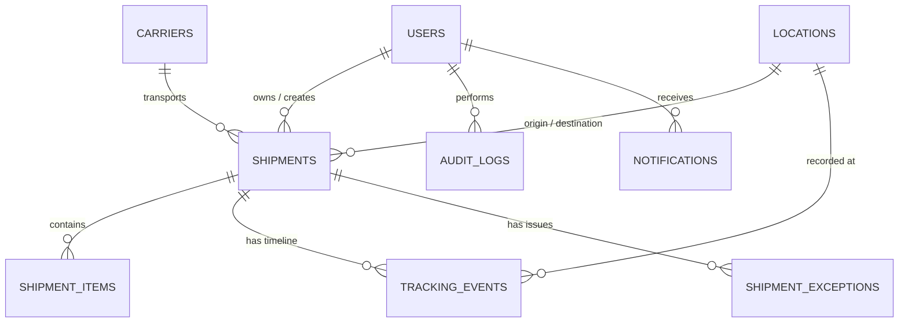

# CargoTrace

Global shipment visibility and tracking platform built with Laravel and MySQL.
Final project (UAS) for Web Programming 2.

> **Live demo:** _TODO: add URL after deployment_
> **Demo accounts:** see [Demo accounts](#demo-accounts)

## Problem

Shipment information is scattered, customers cannot see the latest status or travel history, delays and
exceptions are not visible in one place, and operators lack a dashboard to prioritize follow-up.

## Solution

CargoTrace lets logistics operators manage shipments, carriers, locations and tracking events, lets customers
follow their own shipments on a timeline and map, detects delays with deterministic rules, and tracks
exceptions such as customs holds.

## Features

- Role-based access control: **Administrator**, **Logistics Operator**, **Customer** (authorization enforced on the server)
- Shipment lifecycle with validated status transitions
  `CREATED → BOOKED → PICKED_UP → IN_TRANSIT → DELIVERED` (and `CANCELLED` from early stages)
- Append-only tracking events with chronological timeline and current location
- ETA and delay detection with configurable severity thresholds
- Exception management (`CUSTOMS_HOLD`, `WEATHER_DELAY`, `PORT_CONGESTION`, `DAMAGED`, `MISROUTED`, `DOCUMENTATION_ISSUE`)
  with `OPEN → INVESTIGATING → RESOLVED` workflow
- REST API secured with Laravel Sanctum
- In-app notifications and audit log
- Search, filter, sorting and server-side pagination

_Planned / in progress: web UI, Leaflet map, dashboard charts, external API integration (geocoding/weather)._

## Business rules

**Status transitions** are defined once in `App\Enums\ShipmentStatus` and enforced in
`ShipmentService::changeStatus()`. Terminal states (`DELIVERED`, `CANCELLED`) cannot be left.

**Delay rule** (`App\Services\DelayCalculator`):

```
delay = estimated arrival - expected arrival
delay <= grace period                 -> on time
delay <= DELAY_LOW_MAX_HOURS          -> LOW
delay <= DELAY_MEDIUM_MAX_HOURS       -> MEDIUM
otherwise                             -> HIGH
```

Defaults: LOW up to 6 h, MEDIUM up to 24 h, HIGH above 24 h. Delivered shipments are judged on the actual delivery time.
The reason and the values used are stored in `shipments.delay_reason`.

## Tech stack

PHP 8.3, Laravel 12, MySQL 8, Eloquent ORM, Laravel Sanctum, PHPUnit.
Planned: Blade, Tailwind CSS, Vanilla JS (Fetch API), Leaflet + OpenStreetMap, Chart.js.

## Architecture

```
Routes + Middleware -> Controllers -> Service Layer -> Models (Eloquent) -> MySQL
```

Diagram: [docs/ARCHITECTURE.md](docs/ARCHITECTURE.md).

| Layer | Location | Responsibility |
|---|---|---|
| Controllers | `app/Http/Controllers/Api` | HTTP only: validate, authorize, call services, shape responses |
| Form Requests | `app/Http/Requests` | Input validation and request-level authorization |
| Services | `app/Services` | Business rules and database transactions |
| Policies / Gates | `app/Policies`, `AppServiceProvider` | Authorization rules |
| Models / Enums | `app/Models`, `app/Enums` | Relationships and status transition map |

## Getting started

Requirements: PHP 8.3+, Composer, MySQL 8+, Git.

```bash
git clone <repository-url> cargotrace
cd cargotrace
composer install
cp .env.example .env
php artisan key:generate
```

Create an empty MySQL database and set it in `.env`:

```env
DB_CONNECTION=mysql
DB_HOST=127.0.0.1
DB_PORT=3306
DB_DATABASE=cargotrace
DB_USERNAME=root
DB_PASSWORD=

# Group-specific delay parameters
DELAY_LOW_MAX_HOURS=6
DELAY_MEDIUM_MAX_HOURS=24
DELAY_GRACE_MINUTES=0
```

Run migrations and seed demo data, then start the server:

```bash
php artisan migrate --seed
php artisan serve
```

### Demo accounts

Password for all accounts: `password`

| Role | Email |
|---|---|
| Administrator | admin@cargotrace.test |
| Logistics Operator | operator@cargotrace.test |
| Customer | customer1@cargotrace.test |
| Customer | customer2@cargotrace.test |

Demo data is synthetic. It is generated through the same services the API uses, so statuses, delays,
notifications and audit logs are consistent.

## REST API

All endpoints return JSON. Authenticate with a Sanctum bearer token obtained from `POST /api/login`
and send `Accept: application/json`.

| Method | Endpoint | Description | Access |
|---|---|---|---|
| POST | `/api/register` | Register (always creates a Customer) | Public |
| POST | `/api/login` | Get an API token | Public |
| POST | `/api/logout` | Revoke the current token | Authenticated |
| GET | `/api/user` | Current user | Authenticated |
| GET | `/api/shipments` | List (filter, sort, paginate) | Authenticated (customers see only their own) |
| POST | `/api/shipments` | Create a shipment | Admin, Operator |
| GET | `/api/shipments/{id}` | Shipment details | Owner, Admin, Operator |
| PUT/PATCH | `/api/shipments/{id}` | Update shipment data | Admin, Operator (non-terminal) |
| DELETE | `/api/shipments/{id}` | Delete (only `CREATED`/`CANCELLED`) | Admin |
| GET | `/api/shipments/{id}/tracking` | Timeline and current location | Owner, Admin, Operator |
| POST | `/api/shipments/{id}/tracking` | Add a tracking event / change status | Admin, Operator |
| GET | `/api/shipments/{id}/exceptions` | List exceptions | Owner, Admin, Operator |
| POST | `/api/shipments/{id}/exceptions` | Open an exception | Admin, Operator |
| PATCH | `/api/exceptions/{id}` | Update exception status | Admin, Operator |
| GET/POST | `/api/carriers` | List / create carriers | Read: Admin, Operator. Create: Admin |
| GET/POST | `/api/locations` | List / create locations | Read: Admin, Operator. Create: Admin |

List filters for `GET /api/shipments`: `search`, `status`, `carrier_id`, `origin_id`, `destination_id`,
`from`, `to`, `delayed` (`1`/`0`), `sort`, `direction`, `per_page`.

Status codes: `200`/`201`/`204` success, `401` unauthenticated, `403` forbidden, `404` not found,
`422` validation or invalid transition. Errors never expose stack traces.

_TODO: add the Postman collection to `docs/`._

## Testing

```bash
php artisan test
```

Tests use an in-memory SQLite database. They cover authentication, shipment CRUD with validation and
authorization, status transitions, tracking rules, delay rules and exception workflow.

## Security

- Passwords hashed (bcrypt); Sanctum token authentication
- Authorization enforced on the server with Policies and Gates (not only hidden buttons)
- Form Request validation; mass-assignment protection (`role`, `status` and delay fields are not fillable)
- Eloquent query builder (SQL injection safe); CSRF and XSS protection for web pages
- `.env` and API keys are never committed

## Documentation

- [Database design: ERD and data dictionary](docs/ERD.md)
- [Architecture and lifecycle diagrams](docs/ARCHITECTURE.md)
- _TODO: Postman collection in `docs/`._

### Entity Relationship Diagram (overview)



Full column-level diagram: [docs/ERD.md](docs/ERD.md).

## Known limitations and future work

- _TODO: fill in before submission._

## Attribution

- [Laravel](https://laravel.com) (MIT) and [Laravel Sanctum](https://laravel.com/docs/sanctum) (MIT)
- _TODO: Leaflet, OpenStreetMap, Chart.js, Tailwind CSS and any external code used._

## License

Academic project for Web Programming 2.
