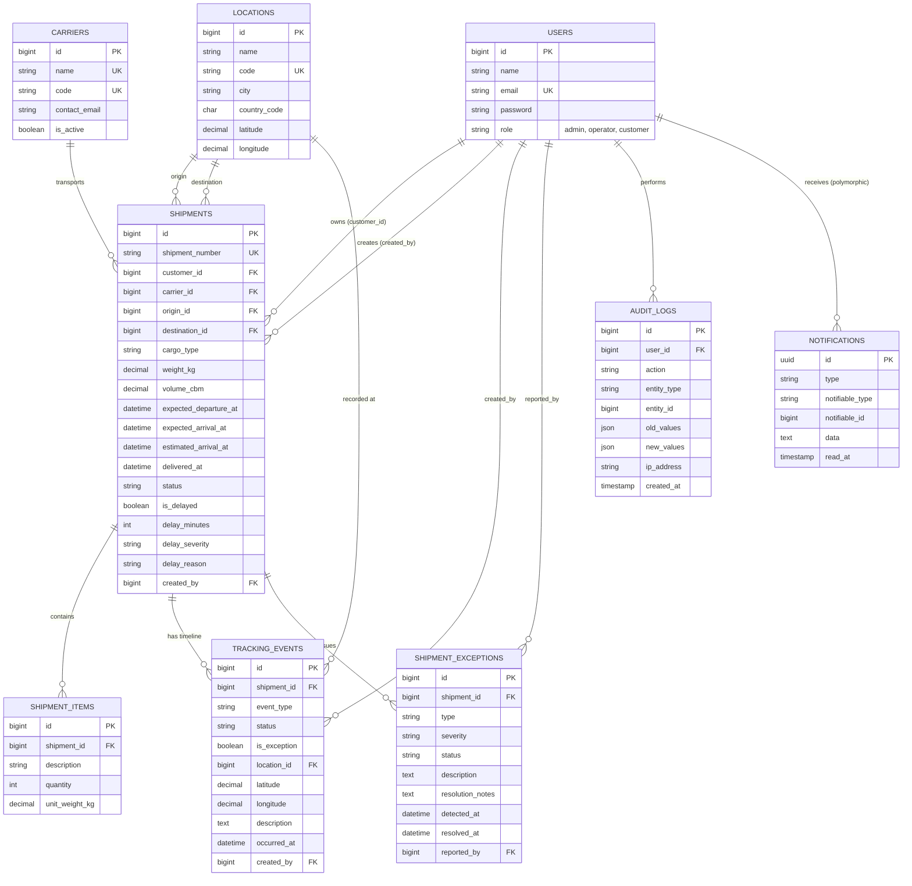

# Database Design

## Entity Relationship Diagram

### Relationships

| Parent | Child | Type | Meaning |
|---|---|---|---|
| users | shipments (`customer_id`) | 1 : N | A customer owns many shipments |
| users | shipments (`created_by`) | 1 : N | A staff member creates many shipments |
| carriers | shipments | 1 : N | A carrier transports many shipments |
| locations | shipments (`origin_id`, `destination_id`) | 1 : N (twice) | A location is the origin or destination of many shipments |
| shipments | shipment_items | 1 : N | A shipment contains several cargo lines |
| shipments | tracking_events | 1 : N | Append-only timeline of a shipment |
| shipments | shipment_exceptions | 1 : N | A shipment can have several incidents |
| locations | tracking_events | 1 : N (optional) | An event may be recorded at a known location |
| users | tracking_events, shipment_exceptions, audit_logs | 1 : N | Who created, reported or performed the action |
| users | notifications | 1 : N (polymorphic) | Laravel database notifications (`notifiable_type`, `notifiable_id`) |

## Data Dictionary

### users
| Column | Type | Constraints | Description |
|---|---|---|---|
| id | bigint unsigned | PK | Identifier |
| name | varchar(255) | required | Display name |
| email | varchar(255) | unique, required | Login email |
| password | varchar(255) | required | Bcrypt hash |
| role | varchar(20) | default `customer`, indexed | `admin`, `operator` or `customer` |
| email_verified_at, remember_token, created_at, updated_at | | | Laravel defaults |

### carriers
| Column | Type | Constraints | Description |
|---|---|---|---|
| id | bigint unsigned | PK | Identifier |
| name | varchar(255) | unique | Carrier name |
| code | varchar(10) | unique | Short code |
| contact_email | varchar(255) | nullable | Operations contact |
| is_active | boolean | default true | Inactive carriers cannot be assigned |

### locations
| Column | Type | Constraints | Description |
|---|---|---|---|
| id | bigint unsigned | PK | Identifier |
| name | varchar(255) | required | Port or facility name |
| code | varchar(10) | unique | Location code (e.g. IDJKT) |
| city | varchar(255) | required | City |
| country_code | char(2) | required | ISO country code |
| latitude | decimal(10,7) | required, -90..90 | Latitude |
| longitude | decimal(10,7) | required, -180..180 | Longitude |

### shipments
| Column | Type | Constraints | Description |
|---|---|---|---|
| id | bigint unsigned | PK | Identifier |
| shipment_number | varchar(30) | unique | Public number, format `CT-YYYYMMDD-XXXXXX` |
| customer_id | bigint unsigned | FK users, restrict | Owner of the shipment |
| carrier_id | bigint unsigned | FK carriers, restrict | Assigned carrier |
| origin_id / destination_id | bigint unsigned | FK locations, restrict | Route endpoints (must differ) |
| cargo_type | varchar(100) | required | Cargo category |
| weight_kg | decimal(12,2) | required, > 0 | Total weight |
| volume_cbm | decimal(12,2) | nullable | Total volume |
| expected_departure_at | datetime | required | Planned departure |
| expected_arrival_at | datetime | required, after departure | Planned arrival (the SLA reference) |
| estimated_arrival_at | datetime | nullable | Current ETA, updated by tracking events |
| delivered_at | datetime | nullable | Actual delivery time |
| status | varchar(20) | default `CREATED`, indexed | `CREATED`, `BOOKED`, `PICKED_UP`, `IN_TRANSIT`, `DELIVERED`, `CANCELLED` |
| is_delayed | boolean | default false, indexed | Result of the delay rule |
| delay_minutes | int unsigned | default 0 | Delay length in minutes |
| delay_severity | varchar(10) | nullable | `LOW`, `MEDIUM` or `HIGH` |
| delay_reason | varchar(500) | nullable | Human-readable explanation with the values used |
| created_by | bigint unsigned | FK users, restrict | Staff member who created it |

Indexes: `status`, `is_delayed`, `expected_arrival_at`, (`customer_id`, `status`).

### shipment_items
| Column | Type | Constraints | Description |
|---|---|---|---|
| id | bigint unsigned | PK | Identifier |
| shipment_id | bigint unsigned | FK shipments, cascade | Parent shipment |
| description | varchar(255) | required | Item description |
| quantity | int unsigned | default 1 | Units |
| unit_weight_kg | decimal(10,2) | nullable | Weight per unit |

### tracking_events
| Column | Type | Constraints | Description |
|---|---|---|---|
| id | bigint unsigned | PK | Identifier |
| shipment_id | bigint unsigned | FK shipments, cascade | Parent shipment |
| event_type | varchar(50) | required | Status value or free type (`UPDATE`, `EXCEPTION`, ...) |
| status | varchar(20) | nullable | New shipment status if this event changed it |
| is_exception | boolean | default false | Marks exception events on the timeline |
| location_id | bigint unsigned | FK locations, null on delete | Known location, if any |
| latitude / longitude | decimal(10,7) | nullable | Position used for the map |
| description | text | nullable | Details |
| occurred_at | datetime | required | When the event happened |
| created_by | bigint unsigned | FK users, restrict | Who recorded it |

Index: (`shipment_id`, `occurred_at`). Rows are append-only: the application never updates or deletes events.

### shipment_exceptions
| Column | Type | Constraints | Description |
|---|---|---|---|
| id | bigint unsigned | PK | Identifier |
| shipment_id | bigint unsigned | FK shipments, cascade | Affected shipment |
| type | varchar(30) | required | `CUSTOMS_HOLD`, `WEATHER_DELAY`, `PORT_CONGESTION`, `DAMAGED`, `MISROUTED`, `DOCUMENTATION_ISSUE` |
| severity | varchar(10) | required | `LOW`, `MEDIUM`, `HIGH` |
| status | varchar(20) | default `OPEN` | `OPEN` → `INVESTIGATING` → `RESOLVED` |
| description | text | required | What happened |
| resolution_notes | text | nullable | Required when resolving |
| detected_at | datetime | required | Detection time |
| resolved_at | datetime | nullable | Set when status becomes `RESOLVED` |
| reported_by | bigint unsigned | FK users, restrict | Reporter |

Indexes: (`shipment_id`, `status`), `status`.

### notifications
Standard Laravel database-notification table: `id` (uuid, PK), `type`, `notifiable_type`, `notifiable_id`, `data` (JSON text), `read_at`, timestamps.

### audit_logs
| Column | Type | Constraints | Description |
|---|---|---|---|
| id | bigint unsigned | PK | Identifier |
| user_id | bigint unsigned | FK users, null on delete | Actor |
| action | varchar(60) | indexed | e.g. `shipment.status_changed` |
| entity_type / entity_id | varchar(60) / bigint | indexed together | Affected record |
| old_values / new_values | json | nullable | Before and after values |
| ip_address | varchar(45) | nullable | Request IP |
| created_at | timestamp | default now | When it happened |

### Framework tables
`personal_access_tokens` (Laravel Sanctum), plus Laravel defaults `cache`, `jobs`, `migrations`, `password_reset_tokens` and `sessions`.
